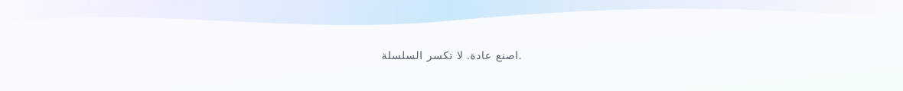

<picture>
  <source media="(prefers-color-scheme: dark)" srcset="assets/brand-hero-dark.svg" />
  
</picture>

---

## 💡 الفكرة

الحفاظ على عادة إسهام يومية هو أقوى طريقة لبناء حضور تقني ثابت. **gh-streak** يرسم لك سلسلة أيامك في طرفية واحدة — بلا تسجيل دخول ولا مفاتيح.

---

## ✨ المزايا

- 📅 **السلسلة الحالية والطويلة**.
- 🔥 **حالة الاتصال** — متصل أو منقطع.
- 🧮 **إحصائيات عامة**.
- 📴 **بلا مصادقة** — قراءة عامة فقط.
- ⚡ **بلا اعتماديات** — Node فقط.
- 🖥️ **تلوين طرفية** و`--no-color`.

---

## 🚀 مزايا مستقبلية

- 📊 **رسم بياني أخضر** كامل.
- 🌍 **واجهات Go/Rust**.
- 🧪 **تغطية اختبار أوسع**.
- ⚙️ **تحسين الأداء** للملفات الكبيرة.

---

## 🧰 التقنيات

| الطبقة | الأدوات |
|:--|:--|
| **التشغيل** | Node.js (بلا اعتماديات) |
| **الاختبار** | node:test |
| **CI** | GitHub Actions (18/20/22) |
| **الترخيص** | MIT |

---

<picture>
  <source media="(prefers-color-scheme: dark)" srcset="assets/brand-foot-dark.svg" />
  
</picture>

